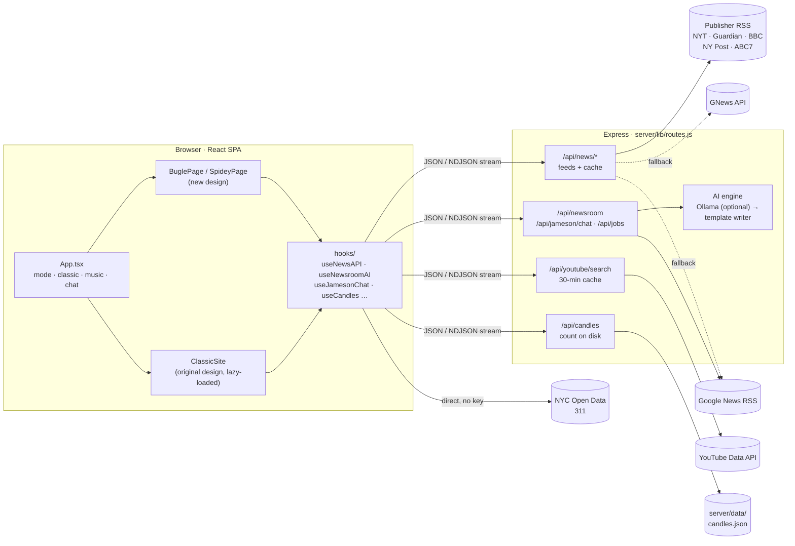

# Daily Bugle Newsroom

A Spider-Man fan site with two identities and a time machine. **Daily Bugle mode** is J. Jonah Jameson's newspaper, rewriting today's real headlines to blame Spider-Man. **Spider-Man mode** is the view through the mask: threat scans, New York crime news and live 311 calls. A Spider-Man Noir button takes the whole site back to its **original design**.

Live at **[daily-bugglespiderman.com](https://daily-bugglespiderman.com)**.

Every data source is free, and no paid AI API is required.

## What's on the site

| | Daily Bugle mode | Spider-Man mode |
| --- | --- | --- |
| **Look** | A two-colour print job: newsprint, ink black, Bugle red, Literata serif | Red and black with spider webs, Archivo grotesk |
| **Live desk** | *Stop the presses*: type a topic and Jameson writes the front page word by word | *Scan for threats*: rates a topic Green, Yellow or Red and recommends actions |
| **News** | National front page (NYT, The Guardian, BBC) with each story's photo | New York crime and police news (NY Post, ABC7 New York, NYT Metro) |
| **Extras** | *Hero vs Menace* comparison, Jameson's editorial, **Call Jameson** chat | NYC 311 calls, YouTube news clips, day jobs, the three Spider-Men, Ben Parker memorial |

Across both modes:

- **Sticky section bar** that highlights the section you're reading, with switches for the theme music and cursor effects
- **Theme music asks first** before playing when you enter Spider-Man mode
- **Ben Parker memorial** with a candle each visitor can light, and a shared count of everyone who has
- **Noir button** that switches to the original design from before the redesign and back, with a silent-film title card
- **Credits** on every photo, and a post-it note in the footer for the archive pictures and footage
- **Shareable links:** `?mode=spiderman`, `?classic=1`, `?splash=0`

## Architecture



### One set of routes, two servers

All API routes live in **`server/lib/routes.js`**. They're registered in two places, so development and production can't drift apart:

- **Development:** `src/setupProxy.js` mounts them on the Create React App dev server (port 3000).
- **Production:** `server/index.js` mounts them on Express (port 3001), which also serves the built site and handles CORS and rate limiting (20 requests per minute per visitor). It runs behind nginx with `trust proxy` on, so limits and the candle count see real visitors.

API keys stay on the server in `.env`. The browser never sees them.

### Where the news comes from

`GET /api/news/feed/:name` (`bugle` or `spidey`) works down a fallback chain, so the page always has headlines:

1. **Publisher RSS feeds** (free, no key). Each item's photo is taken from `media:content`, `media:thumbnail` or `enclosure`, and resized where the publisher allows. Feeds are interleaved story by story so no paper dominates. Spider-Man mode puts crime and police stories first.
2. **GNews API**, if `GNEWS_API_KEY` is set.
3. **Google News RSS**, as the last resort (headlines only, no photos).

Results are cached in memory. If a source fails, the last good copy is served instead of an error. The browser also keeps the last headlines in `localStorage`, so the page renders instantly while fresh ones load.

### The live AI desk

`POST /api/newsroom` takes `{ query, mode }` and works like this:

1. Fetches real headlines for the topic from Google News RSS, so the story is grounded in today's news.
2. Asks the AI engine for a structured JSON article (Jameson) or threat report (Spider-Sense).
3. **Streams** the answer back as NDJSON: `{"type":"token"}` chunks, then a final `{"type":"done","engine":…}`. The browser reads fields out of the half-finished JSON (`readPartialField`) to type the story out live.

`/api/jameson/chat` streams plain text for the **Call Jameson** chat, and `/api/jobs` returns the day-job listings.

**The AI engine is pluggable.** If an [Ollama](https://ollama.com) server is reachable, the routes stream from a local open model, through a queue that runs one generation at a time and holds at most 6 waiting (`OLLAMA_CONCURRENCY`, `OLLAMA_MAX_QUEUE`). If not, a **template writer** builds the article, threat report, jobs or chat reply from the real headlines instantly. The live site runs on the template writer and needs no model.

Finished articles are cached per topic for 6 hours, so repeat searches are instant.

### Caches and limits

| What | Where | How long | Why |
| --- | --- | --- | --- |
| Publisher feeds | server memory | 15 min | Fresh enough; no quota at all |
| GNews headlines | server memory | 30 min | Stays under the free 100 requests/day |
| YouTube search | server memory | 30 min | Each search costs 100 of the 10,000 free daily units |
| AI articles | server memory | 6 h | Repeat topics come back instantly |
| Headlines | browser `localStorage` | 24 h | Instant first paint on return visits |
| Candle count | `server/data/candles.json` | permanent | Survives restarts; git-ignored |

Every server cache serves its last good copy when a source fails.

### Candles for Ben

`GET /api/candles` returns the shared count. `POST /api/candles` lights one, limited to one per visitor per day. Visitor addresses are held in memory only for that check, and never written to disk. The count is saved to disk with a write-then-rename, so a crash can't corrupt it.

### Frontend

- **`App.tsx`** owns the app-wide state: the current mode (`peter` or `spiderman`), the classic switch, the theme-music choice and the chat window. It renders the new pages, or **`ClassicSite`**, which is loaded with `React.lazy` so the original design only downloads when someone presses the Noir button.
- **Pages** (`BuglePage`, `SpideyPage`) are built from section components. Shared pieces sit in `components/shared`: the sticky `BoardBar`, `WireTable`, the credited `NewsPhoto`, `JamesonChat` and `Footer`.
- **Hooks** do the data work: `useNewsAPI`, `useNewsroomAI` (reads the stream), `useJamesonChat`, `useJobSearch`, `useNYC311`, `useYouTubeNews`, `useCandles`, `useYouTubePlayer`, and `useReveal` for the scroll entrances.
- **Styling:** `src/styles/newsroom.css` holds the design system. Each mode only swaps a set of CSS variables (`.peter-mode`, `.spiderman-mode`), and the components use those tokens. Tailwind remains for the classic components. Every animation has a `prefers-reduced-motion` fallback.

### API reference

| Method | Route | Returns |
| --- | --- | --- |
| GET | `/api/news/feed/:name` | `{ status, totalResults, articles[] }` for `bugle` or `spidey` |
| GET | `/api/news/top-headlines` · `/api/news/search?q=` | Same shape, GNews with an RSS fallback |
| POST | `/api/newsroom` | NDJSON stream: tokens, then `{ type: "done", text, engine }` |
| POST | `/api/jameson/chat` | Plain-text stream of Jameson's reply |
| POST | `/api/jobs` | `{ jobs[], engine }`, each linking to a live Indeed search |
| GET | `/api/youtube/search?q=` | `{ videos[] }` |
| GET / POST | `/api/candles` | `{ count }` / `{ count, counted }` |

## Project structure

```text
server/
├── index.js                 # Production: Express, CORS, rate limit, trust proxy, serves build/
└── lib/
    ├── routes.js            # Every API route: feeds, caches, AI engine + queue, templates, candles
    └── prompts.js           # Jameson, Spider-Sense, job and chat personas
src/
├── App.tsx                  # Mode, classic switch, music, chat, splash
├── App.css                  # Splash, mode transitions, spider and Noir toggles, intertitle
├── setupProxy.js            # Mounts server/lib/routes.js on the dev server
├── styles/newsroom.css      # Design system: tokens per mode, layouts, motion
├── components/
│   ├── bugle/               # BuglePage, BugleFront, BuglePress, BugleSections
│   ├── spidey/              # SpideyPage, SpideyFront, ThreatScanner, CommunitySection (311),
│   │                        # LiveFeed, JobBoard, SpiderMen, UncleBenReminder, MusicPrompt
│   ├── shared/              # BoardBar, WireTable, NewsPhoto, JamesonChat, Footer
│   ├── ModeToggle.tsx       # Spider logo: Bugle ⇄ Spider-Man
│   ├── NoirToggle.tsx       # Spider-Man Noir: new design ⇄ original design
│   ├── SplashScreen.tsx     # Intro, once per browser session
│   └── WebShooterCursor.tsx # Canvas cursor trails (mounts on the first mouse move)
├── classic/                 # The original design, kept intact, lazy-loaded
├── hooks/                   # Data and behaviour (see Frontend above)
├── utils/                   # parseArticle (incl. readPartialField), time
├── assets/                  # Images, footage, web SVGs; photos/credits.json lists every source
└── types/                   # Shared TypeScript types
```

## Getting started

Requires **Node.js 20+**.

```bash
git clone https://github.com/Pedriux0/daily-bugle-newsroom.git
cd daily-bugle-newsroom
npm install --legacy-peer-deps
cp .env.example .env    # then add your keys; .env is git-ignored
npm start               # http://localhost:3000
```

### Environment variables

| Variable | Needed? | Purpose |
| --- | --- | --- |
| `YOUTUBE_API_KEY` | For the video feed | [Google Cloud console](https://console.cloud.google.com/apis), free 10,000 units/day |
| `GNEWS_API_KEY` | Optional | Extra news fallback ([gnews.io](https://gnews.io/register), free 100 req/day) |
| `OLLAMA_URL`, `OLLAMA_MODEL` | Optional | Use a local open model instead of the template writer (default `http://127.0.0.1:11434`, `llama3.2:3b`) |
| `OLLAMA_CONCURRENCY`, `OLLAMA_MAX_QUEUE` | Optional | Model queue size (defaults 1 and 6) |
| `CANDLES_FILE` | Optional | Where the candle count is stored (default `server/data/candles.json`) |
| `PORT`, `FRONTEND_URL` | Production | Server port (default 3001) and an extra allowed CORS origin |

Keep real keys in `.env` only. `.env.example` holds placeholders and is committed.

### Optional: a local AI model

```bash
curl -fsSL https://ollama.com/install.sh | sh
ollama pull llama3.2:3b
```

With Ollama running, the desk, chat and jobs stream from the model; without it, they use the template writer. A small CPU-only server is better off with the template writer than a slow model.

### Production

```bash
npm run build
pm2 start server/index.js --name daily-bugle   # serves build/ and the API on PORT
```

Put nginx (or another proxy) in front, and forward the visitor's address so rate limits and the candle count work:

```nginx
location / {
    proxy_pass http://localhost:3001;
    proxy_set_header Host $host;
    proxy_set_header X-Real-IP $remote_addr;
    proxy_set_header X-Forwarded-For $proxy_add_x_forwarded_for;
    proxy_set_header X-Forwarded-Proto $scheme;
}
```

The streaming routes send `X-Accel-Buffering: no`, so nginx passes the live text through without buffering it.

To update a running server: `git pull`, then `npm ci --legacy-peer-deps`, then `npm run build`, then `pm2 restart daily-bugle`.

## Cost

$0 per visit:

- **News:** publisher RSS feeds, no key or quota, with GNews and Google News as fallbacks
- **AI desk:** the template writer, or a local open model if you run one
- **Video:** YouTube free tier, kept small by the 30-minute cache
- **311 calls:** NYC Open Data, no key

## Credits

- **News photos** belong to their publishers. Each is credited under the picture and links to the original story.
- **Archive photographs, press footage, actor portraits and the Spider-Man Noir photo** are public domain or Creative Commons. They're listed in `src/assets/photos/credits.json` and on the footer post-it, and the actors' photos don't imply endorsement.
- **Spider-Man and related characters** belong to Marvel. This is a non-commercial fan project, not affiliated with Marvel.

## What I learned

1. **API keys:** proxying every secret through a backend, rate limiting, `.env` hygiene in a public repo
2. **AI agents:** one engine, very different behaviour through personas; streaming structured output; designing a no-model fallback
3. **Real-time data:** combining publisher RSS, GNews, YouTube and NYC Open Data, with caching and graceful fallbacks
4. **Design systems:** two themes from one set of tokens, accessible motion, credited imagery
5. **Deployment:** Express behind nginx, pm2, trusting proxy headers, safe redeploys with backups

## License

MIT for the code. Third-party photos and footage keep their own licences (see Credits).

---

*"With great power comes great responsibility." — Uncle Ben*
